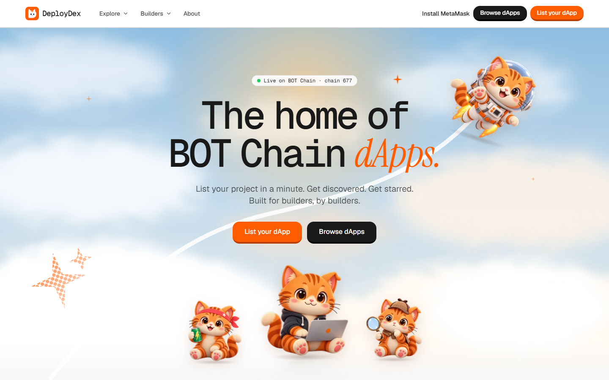
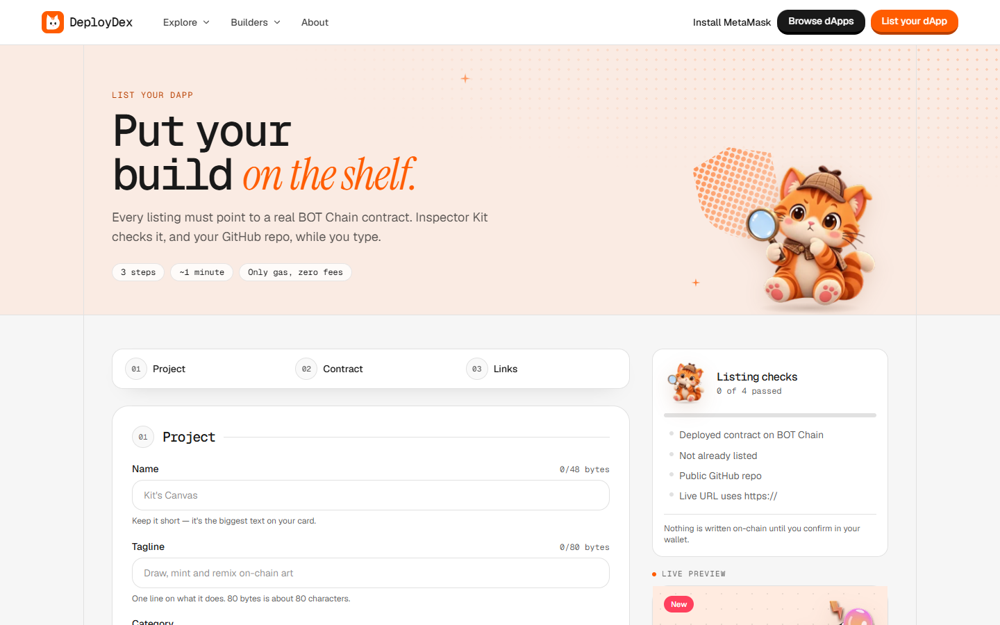
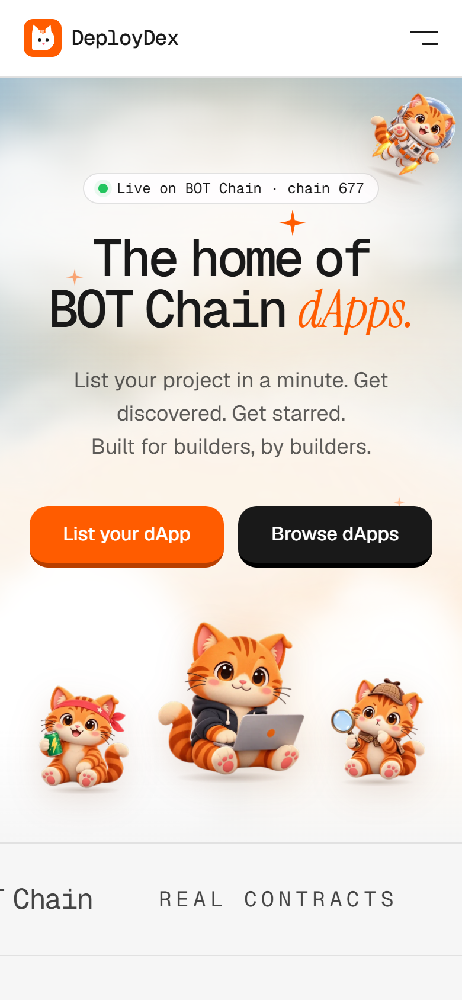
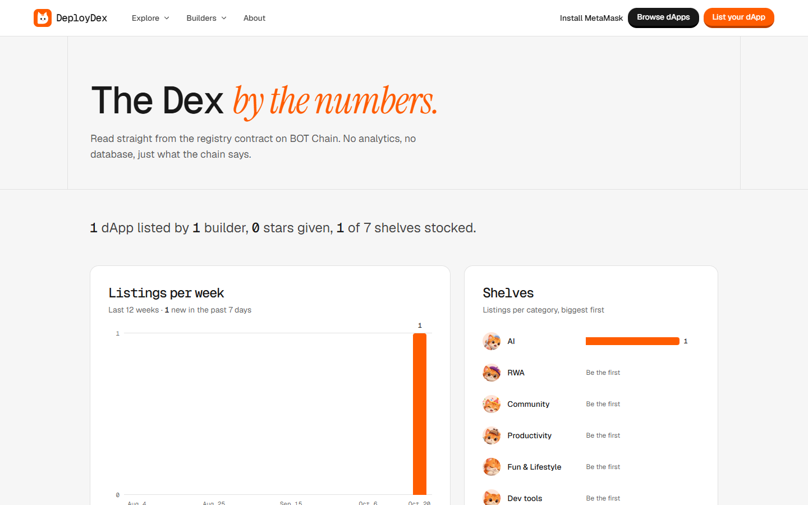
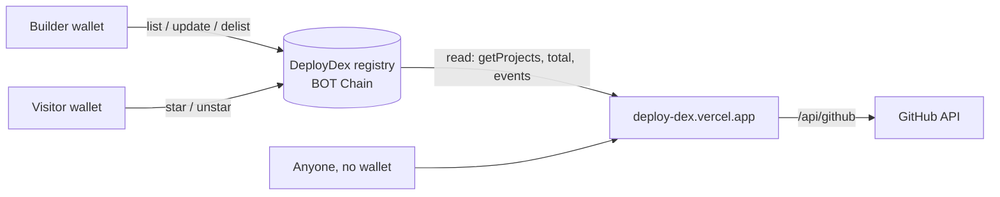

<div align="center">


# DeployDex

**The on-chain home of BOT Chain dApps.**
List your project with its contract, live link and GitHub repo, and let the community browse and ⭐ star the best ones. Hosted by Kit, our orange tabby.

_Ship it. List it. Get starred._

[](https://deploy-dex.vercel.app)
[](https://scan.botchain.ai/address/0xCeA0C0db0F86d75CeE6e8d70e2b20488Fa5cD884)


[Live site](https://deploy-dex.vercel.app) · [Browse dApps](https://deploy-dex.vercel.app/dapps) · [List your dApp](https://deploy-dex.vercel.app/list) · [Dex stats](https://deploy-dex.vercel.app/stats)

</div>

<br />

<p align="center">
  
</p>

## Why DeployDex

BOT Chain builders ship real contracts, but there is no single place to find them. DeployDex is that shelf:

- **Every listing is a real contract.** The registry rejects wallets and empty addresses (`target.code.length > 0`), on the chain it lives on.
- **No backend, no database.** The site reads the registry contract directly. Browsing needs no wallet and no MetaMask.
- **Stars live on-chain.** One star per wallet per dApp, and you can't star your own project.
- **Builders stay in control.** Edit your listing any time, or delist it.

## Features

| | |
|---|---|
| 🗂️ **Directory** | Search, filter by category, sort by stars, newest or recently updated. |
| 📝 **List in a minute** | Six fields with live checks while you type: contract on BOT Chain, not already listed, public GitHub repo, `https://` live URL. A live card preview shows what you'll publish. |
| 🔍 **Trust report** | Each project page shows verified source, deployer, owner and repo claim, plus the repo's README. |
| ⭐ **On-chain stars** | Star and unstar from the card or the project page, with a little Kit party when it lands. |
| 🙋 **My dApps** | Your listings (edit, delist) and everything you've starred. |
| 📊 **Dex stats** | Listings per week, shelves per category and a live chain log, straight from the contract. |
| 🐱 **Kit** | Seven HD poses and per-category art, with motion that honors `prefers-reduced-motion`. |

<table>
  <tr>
    <td width="68%"></td>
    <td width="32%" rowspan="2"></td>
  </tr>
  <tr>
    <td></td>
  </tr>
</table>

## Meet Kit

<p align="center">
  
  
  
  
  
  
  
</p>

<p align="center"><sub>dev · hackathon · astro · inspector · curator · napping · party</sub></p>

## How it works



1. `contracts/DeployDex.sol` stores every listing on BOT Chain.
2. The website reads that contract. You don't need a wallet to browse.
3. To list or star, connect MetaMask. The site switches you to BOT Chain.
4. A listing must point to a real deployed contract on the registry's own chain. Testnet addresses can't be listed on mainnet.

## Contracts

| Network | Chain ID | Registry | Explorer |
|---|---|---|---|
| **BOT Chain mainnet** (production) | `677` | `0xCeA0C0db0F86d75CeE6e8d70e2b20488Fa5cD884` | [scan.botchain.ai](https://scan.botchain.ai/address/0xCeA0C0db0F86d75CeE6e8d70e2b20488Fa5cD884) |
| BOT Chain testnet | `968` | `0x5863636C9308E1318ef4F159bD5019c67C2F6b83` | [scan.bohr.life](https://scan.bohr.life/address/0x5863636C9308E1318ef4F159bD5019c67C2F6b83) |

**Registry API:** `list`, `update`, `star`, `unstar`, `delist` (lister), `setHidden` (curator), and views `getProject`, `getProjects`, `listedOf`, `starredOf`, `isStarred`, `idOfTarget`, `delisted`, `total`.
Delisted and hidden entries stay in `total()` but are filtered out everywhere on the site.

## Tech stack

- **Web:** Next.js 16 (App Router) · React 19 · TypeScript strict · Tailwind CSS v4 · TanStack Query · zod
- **Web3:** wagmi + viem, MetaMask, BOT Chain RPC
- **Motion:** GSAP (ScrollTrigger, SplitText) for desktop scenes, CSS reveals on phones
- **Contract:** Solidity ^0.8.20, tested with Foundry, deployed with Remix
- **Hosting:** Vercel

## Project layout

| Path | What |
|---|---|
| `contracts/DeployDex.sol` | The registry |
| `contracts/test/` | Foundry tests (`DeployDex.t.sol`); manual two-wallet steps in `contracts/test-notes.md` |
| `apps/web` | The Next.js site |
| `apps/web/src/lib/config.ts` | Single source of truth for chain and registry address |
| `docs/` | PRD, architecture, deploy guide, category art notes |
| `CLAUDE.md`, `DESIGN.md` | Rules for coding agents and the design system |

## Run locally

```bash
npm install
cp apps/web/.env.example apps/web/.env.local   # then fill in the values below
npm run dev                                    # http://localhost:3000
```

| Variable | Value |
|---|---|
| `NEXT_PUBLIC_CHAIN` | `mainnet` (677) or `testnet` (968) |
| `NEXT_PUBLIC_REGISTRY_MAINNET` | `0xCeA0C0db0F86d75CeE6e8d70e2b20488Fa5cD884` |
| `NEXT_PUBLIC_REGISTRY_TESTNET` | `0x5863636C9308E1318ef4F159bD5019c67C2F6b83` |
| `NEXT_PUBLIC_SITE_URL` | Public URL, used by the sitemap and social cards |
| `GITHUB_TOKEN` | Optional, server-only. Lifts the GitHub rate limit for repo checks. Never prefix it with `NEXT_PUBLIC_`. |

`npm run check` runs typecheck, lint, tests and build. Run it before every commit.

## Deploy

**Contract (Remix).** Compile `contracts/DeployDex.sol` with 0.8.20+, deploy on testnet first (chain 968, RPC `https://rpc.bohr.life`), then mainnet (chain 677, RPC `https://rpc.botchain.ai`). The deployer becomes the curator. One registry per network.

**Site (Vercel).** Import the repo with root directory `apps/web`, add the variables above, deploy. `NEXT_PUBLIC_*` values are baked in at build time, so redeploy after changing them.

Step by step, including seeding listings and the launch checklist: [`docs/DEPLOY.md`](docs/DEPLOY.md).

## Docs

- [`docs/PRD.md`](docs/PRD.md): product spec
- [`docs/ARCHITECTURE.md`](docs/ARCHITECTURE.md): data flow
- [`docs/DEPLOY.md`](docs/DEPLOY.md): deploy guide
- [`DESIGN.md`](DESIGN.md): visual rules
- [`docs/CATEGORY_ART.md`](docs/CATEGORY_ART.md): rendering new category art

---

<div align="center">
<sub>DeployDex is a community directory, not an official BOT Chain product. Listings are submitted by builders: always do your own research before using a dApp.</sub>
<br />
<sub>Built by <a href="https://github.com/Devs-GMT">Devs-GMT</a> · <a href="mailto:hello@girlmeetstech.org">hello@girlmeetstech.org</a></sub>
</div>
